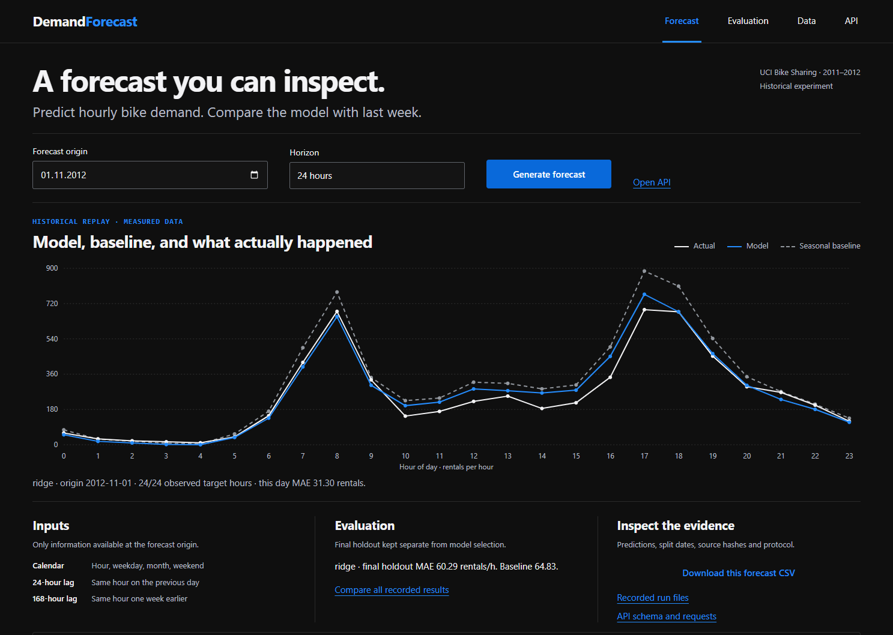
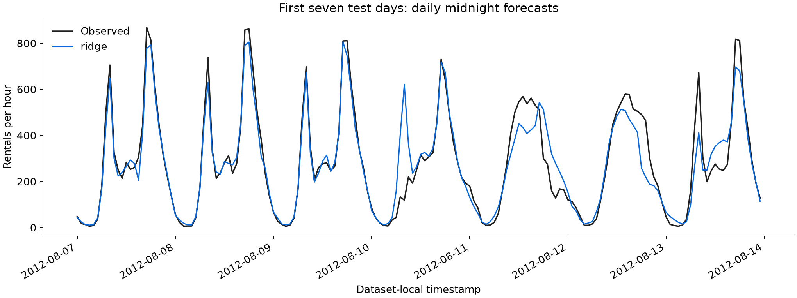
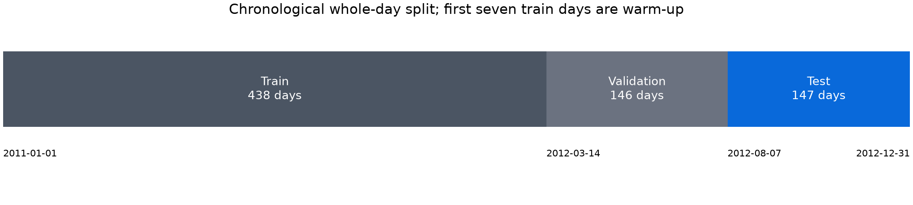

[Annotated application walkthrough](docs/presentation/GALLERY.md) · [Static cover](docs/presentation/cover.png)

# DemandForecast

Forecast the next 24 hourly bicycle-rental counts from one daily midnight origin. Compare predictions with recorded demand, inspect missing history, and call the same Python service through a local API.



[Mobile screenshot](docs/images/app-mobile.png) · [API explorer screenshot](docs/images/api-desktop.png)

The project demonstrates time-aware machine learning: exact timestamp lags, chronological model selection, a seasonal baseline, and a final historical test. It uses the UCI Bike Sharing dataset from 2011–2012. It is a standalone forecasting project alongside the separate Reliable Text Lab.



## Recorded result

The frozen validation rule selected **Ridge regression**. On **3,488 observed test hours**, its MAE was **60.295 rentals/hour**, compared with **64.831** for seasonal naive with fallback. The absolute difference was **−4.536 rentals/hour**, or **6.997% lower MAE** relative to that baseline in this historical period. No uncertainty interval or future-city guarantee is implied.

| Candidate | Validation MAE | Validation RMSE |
|---|---:|---:|
| Seasonal naive with fallback | 62.236 | 106.361 |
| Ridge, alpha 10 | 60.768 | 97.206 |
| Histogram gradient boosting | 66.324 | 104.211 |

Read the [evaluation report](results/report.md), [full metrics](results/metrics.json), and [per-hour predictions](results/predictions.csv). The implementation did not select its model on the test scores.

The gain varies across the holdout. A paired comparison of the same 3,488 observed targets shows **higher model MAE in August (+5.104 rentals/hour) and September (+3.772)**. At 08:00 the model loses by **+20.797 rentals/hour**. It loses on **8/24 clock-hour slices and 65/147 test days**. Positive deltas mean worse model error; negative deltas mean better error. These are post-hoc descriptive results, with no retuning or statistical-significance claim.

Open **Evaluation** for the validation candidates and paired month/hour/day comparisons. [Diagnostic v1](results/diagnostics-v1.md) and its [JSON with source hashes](results/diagnostics-v1.json) derive from the original frozen predictions. Regenerate or check them after installing the package:

```bash
python scripts/derive_diagnostics.py --results results
python scripts/derive_diagnostics.py --results results --check
```

The original model, selection, predictions, metrics and protocol remain byte-for-byte unchanged. The diagnostics API recomputes its response from hash-checked inputs instead of trusting a saved derived summary. See [current scoped verification](docs/VERIFICATION.md#paired-diagnostic-fix-2026-10-20).


## Run locally

Use Python 3.12 or newer. Create a project environment, install this package, and start the app using the included trusted results:

```bash
python -m venv .venv
# Windows PowerShell: .venv\Scripts\Activate.ps1
# Linux/macOS: source .venv/bin/activate
python -m pip install -e ".[dev]"
python -m demand_forecast demo --results results --port 8766
```

Open **http://127.0.0.1:8766**. The app runs on your machine. It requires no API key, account, GPU, or external service for inference. The API tab exposes actual same-origin requests and responses. [API examples and validation rules](docs/API.md) explain integration.

```bash
python -m demand_forecast forecast --results results --origin 2012-08-07
python -m pytest
python scripts/verify_results.py --results results
```

To reproduce the experiment from the official UCI download:

```bash
python -m demand_forecast train --output results-reproduced
```

Training downloads the small source archive and preserves its original readme and hashes. The experiment limits native compute threads to one. Use a new output directory when comparing runs; training intentionally writes its named output files. `--source path/to/hour.csv` accepts an authorized local CSV and marks it as user-supplied provenance.

## Forecasting contract

- At each daily 00:00 origin, predict target hours 0–23. Assume counts through the preceding 23:00 hour are available at midnight.
- Use calendar cycles and exact 24/168-hour count lags. Exclude actual target-day weather and rental-count components.
- Keep absent timestamps unknown. Fit missing-lag medians and preprocessing on training data only.
- Split full calendar days into 60/20/20 chronological partitions, with the first seven training days as warm-up. Validation chooses among baseline, Ridge, and boosting; the chosen learned model refits on development data before the final test.
- During evaluation, use actual history from previous days as it becomes available. Keep model weights frozen. This is a series of day-ahead forecasts.

| Partition | Calendar dates | Days | Observed target hours |
|---|---|---:|---:|
| Train | 2011-01-01 to 2012-03-13 | 438 | 10,389 before warm-up exclusion |
| Validation | 2012-03-14 to 2012-08-06 | 146 | 3,502 |
| Final test | 2012-08-07 to 2012-12-31 | 147 | 3,488 |

The downloaded file has **17,379 rows** across a **17,544-hour grid**, with **165 absent timestamps**. These are counts from the downloaded bytes; the UCI webpage's instance metadata differs. See [source provenance](docs/SOURCES.md), [data validation](results/data_validation.json), and the machine-readable [protocol](results/protocol.json).



## Python use

```python
from pathlib import Path
from demand_forecast.service import ForecastService

service = ForecastService(Path("results"))
forecast = service.forecast("2012-08-07")
custom = service.forecast("2027-01-01", history=[
    {"timestamp": "2026-12-31T00:00:00", "count": 120}
])
```

Custom history never borrows missing values or future truths from the archive. The service uses its training-derived fallback statistics and labels the response `custom_history`. Custom predictions are outside the historical benchmark.

## Repository map

```text
src/demand_forecast/  data validation, training, inference, CLI, HTTP and UI
tests/               time-leakage, validation, service and web checks
results/             actual model, split IDs, predictions, metrics and figures
scripts/             independent result reconciliation
docs/                API, source attribution, model card and screenshots
```

## Limits and reuse

The benchmark covers one old rental system. It does not establish present-day demand, Chinese-city performance, or an effect on fleet operations. Dataset-local timestamps lack an audited UTC/DST reconstruction. The API supplies point forecasts; it does not estimate prediction intervals. A user-supplied history can differ from the training distribution.

The code uses the [MIT license](LICENSE); the dataset keeps [CC BY 4.0 attribution](docs/SOURCES.md). Load only trusted local joblib artifacts. See the [model card](docs/MODEL_CARD.md), [contribution guide](CONTRIBUTING.md), and [changelog](CHANGELOG.md).

Current correction record: [audit fixes and fresh checks](docs/AUDIT_FIXES_2026-10-20.md). This separates the latest focused checks from earlier release evidence.
