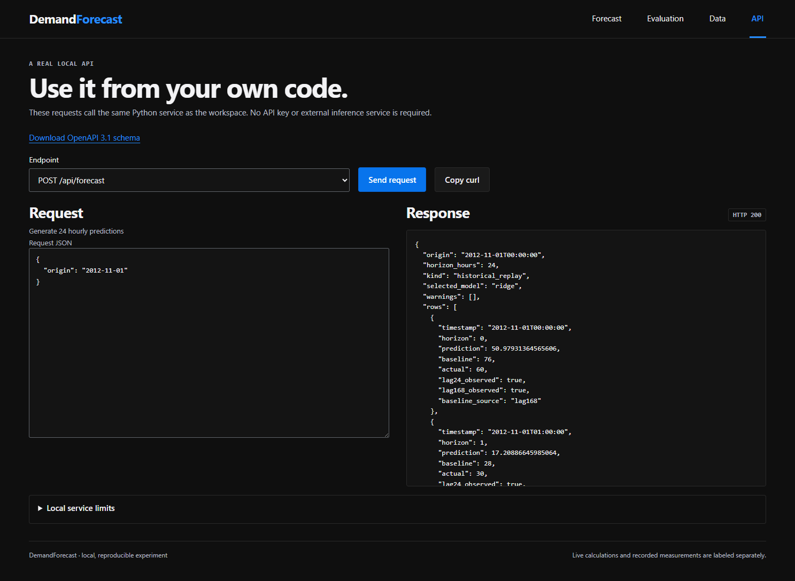

# Local API and Python service

Start `python -m demand_forecast demo --results results --port 8766`. Open the API tab or download `/openapi.json` for the exact HTTP schema. The server binds to 127.0.0.1. It is a local development interface without an authentication layer or public deployment configuration.

## Endpoints

| Method | Path | Purpose |
|---|---|---|
| GET | `/api/health` | Service readiness |
| GET | `/api/meta` | Available final-test origins, selected model, metrics and provenance |
| GET | `/api/evaluation` | Original recorded evaluation metrics; split details are in /api/meta |
| GET | `/api/diagnostics` | Paired final-test MAE by month, target clock hour and day; validation candidates and input hashes |
| POST | `/api/forecast` | Historical replay or explicit custom-history inference |
| GET | `/openapi.json` | Downloadable OpenAPI schema |

Send JSON with `Content-Type: application/json`:

```json
{"origin": "2012-08-07"}
```

For custom history, supply timestamp/count objects:

```json
{
  "origin": "2027-01-01",
  "history": [{"timestamp": "2026-12-31T00:00:00", "count": 120}]
}
```

```python
import json
from urllib.request import Request, urlopen

request = Request(
    "http://127.0.0.1:8766/api/forecast",
    data=json.dumps({"origin": "2012-08-07"}).encode(),
    headers={"Content-Type": "application/json"},
    method="POST",
)
with urlopen(request, timeout=15) as response:
    result = json.load(response)
print(result["rows"][0])
```

## Response semantics

The response contains `origin`, `horizon_hours: 24`, `kind`, `selected_model`, `warnings`, and 24 `rows`. Each row includes a naive-local `timestamp`, zero-based `horizon`, `prediction`, `baseline`, nullable `actual`, and `lag24_observed`/`lag168_observed`. Predictions are continuous nonnegative counts. The additional `baseline_source` identifies a lag or a training-statistic fallback.

`historical_replay` uses previous archived observations and exposes available actual outcomes. `custom_history` uses only the supplied records, returns null actuals, and includes an out-of-benchmark warning. An empty custom history is valid and invokes training-derived fallbacks. It does not restore archive history.

## Validation

Origins must be midnight naive-local dates, either `YYYY-MM-DD` or `YYYY-MM-DDT00:00:00`, with year 1900–2200. Historical replay accepts only available final-test dates. Timezone suffixes and non-midnight origins are rejected.

History accepts at most 10,000 records. Each record contains exactly `timestamp` and `count`; timestamps use a naive ISO whole-hour representation and precede the origin. Duplicate timestamps, negative/fractional/nonfinite counts, booleans and counts over 10,000,000 are invalid. The HTTP adapter adds body-size/content-type limits and rejects unknown request fields. Errors use `{ "error": "...", "code": "..." }` with an optional field name.

For Python, instantiate `ForecastService(Path("results"))`, call `.metadata()` and `.forecast(origin, history=None)`. The loader verifies model and observation hashes before deserializing a trusted artifact. A checksum confirms consistency with the local manifest; it does not make an untrusted pickle safe.

## Inspect requests in the application



The [saved OpenAPI contract](openapi.json) describes request and prediction-response fields. The running server also exposes `/openapi.json`.


## Paired error diagnostic v1

`GET /api/diagnostics` returns `schema_version: 1`, `kind: post_hoc_paired_historical_diagnostic`, `unit: rentals/hour`, `overall`, `by_month`, `by_hour`, `by_day`, `loss_counts`, `validation_candidates`, `limitations` and `lineage`. Each scored slice contains `n` paired observed hours, `model_mae`, `baseline_mae`, and `delta_mae`. Delta means model MAE minus baseline MAE, so positive values identify worse model error.

For midnight origins, target clock hour and zero-based horizon match: hour 0 is 00:00, hour 8 is 08:00. Do not shift these labels by one. `loss_counts` counts slice MAE differences above 1e-12; correlated days/hours do not form independent statistical trials.

The service verifies the prediction CSV against its existing artifact hash, checks protocol/selection/source consistency and reconciles aggregate MAEs, sample counts and test dates. It rejects missing, duplicated, nonfinite or truth-mismatched pairs. A source failure returns HTTP 500 with `code: artifact_error`. Lineage records SHA-256 values for the read inputs and the diagnostic implementation. Local manifest checks establish consistency, not authenticity of untrusted files.

The original `/api/evaluation` contract remains unchanged. The new endpoint performs no fitting, threshold changes, external requests or user-data storage. The app keeps diagnostic errors separate from forecasting and offers **Reload comparisons**.
