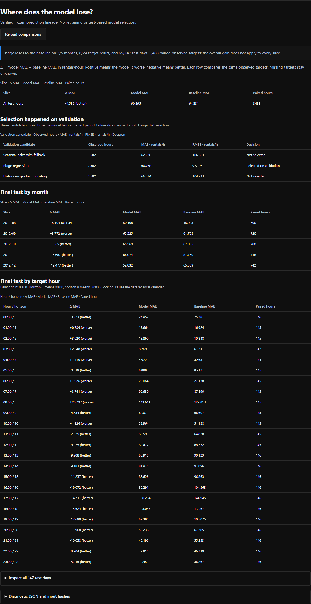

# DemandForecast 0.1.1 integrated verification

The Evaluation view now compares the selected model and seasonal baseline on the same observed final-test targets. It shows month, target clock hour and day, as well as the validation candidates. A positive MAE difference means higher model error. We placed that difference in the second column so narrow screens show the result before the supporting columns.

The recorded model loses on 2 of 5 months, 8 of 24 target hours and 65 of 147 test days. Its overall MAE remains 60.295 versus 64.831 rentals/hour on 3,488 observed targets. At 08:00 the difference is +20.797 rentals/hour; August is +5.104. These are descriptive results from the frozen test period. We did not retune the model after inspecting them.

## Evidence

- 36 Python tests passed. The diagnostic rejects unpaired targets, duplicate keys, mismatched truths, invalid horizons and nonfinite errors; the API reports failures separately.
- Five Node tests passed: rendering/counts/signs, error/retry, stale responses, empty data and nonblocking startup. A held diagnostic request does not delay forecasting or API setup.
- 23 real Chromium assertions passed, including all 176 slices, error and empty states, retry, a pending diagnostic during startup, collapsed raw JSON and actual widths 304, 375, 768 and 1280 px. The signed monthly difference fits at 304 px without internal scrolling. Supporting table columns remain horizontally scrollable.
- The existing verifier reconciled 17,482 prediction rows and 3,488 observed test targets. The diagnostic reproduction check matched the saved JSON and Markdown.
- An independent Model QA Specialist recomputed all 176 slices from paired CSV rows and checked the input/source hashes. An independent Code Reviewer found no blocking functional issue after the startup correction.
- All 21 original result files retain their SHA-256 values. The new diagnostic files add reporting to the frozen experiment.
- An isolated wheel installation served the diagnostic and generated a real 24-hour forecast over loopback HTTP.

Records: [browser cases](verification/diagnostics-browser-2026-10-20.json), [original result preservation](verification/audit-fixes-preservation-2026-10-20.json), [installed wheel](verification/installed-wheel-2026-10-20.json). Reproduce the diagnostic with `python scripts/derive_diagnostics.py --results results --check`.

[Actual 375 px view](images/paired-diagnostics-mobile.png). Both captures show the running local application and recorded historical observations. They contain no generated chart values or decorative image assets.

## Limits

One historical holdout does not establish a stable gain for future cities. This release adds neither prediction intervals nor a paired uncertainty interval. The browser tests cover Chromium and the changed surfaces, with no screen-reader or public-hosting claim.
