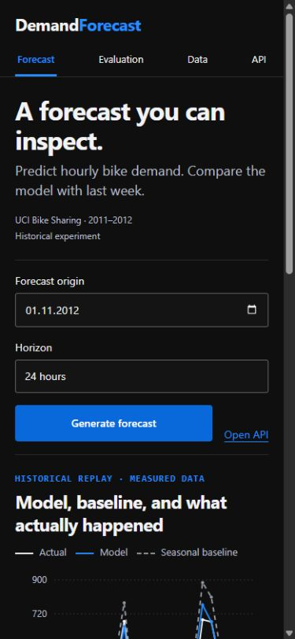
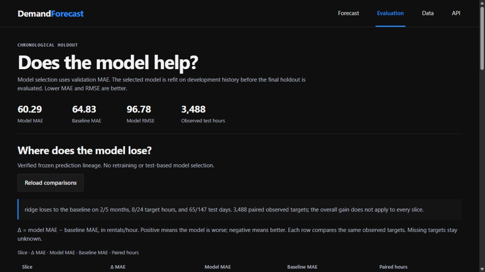
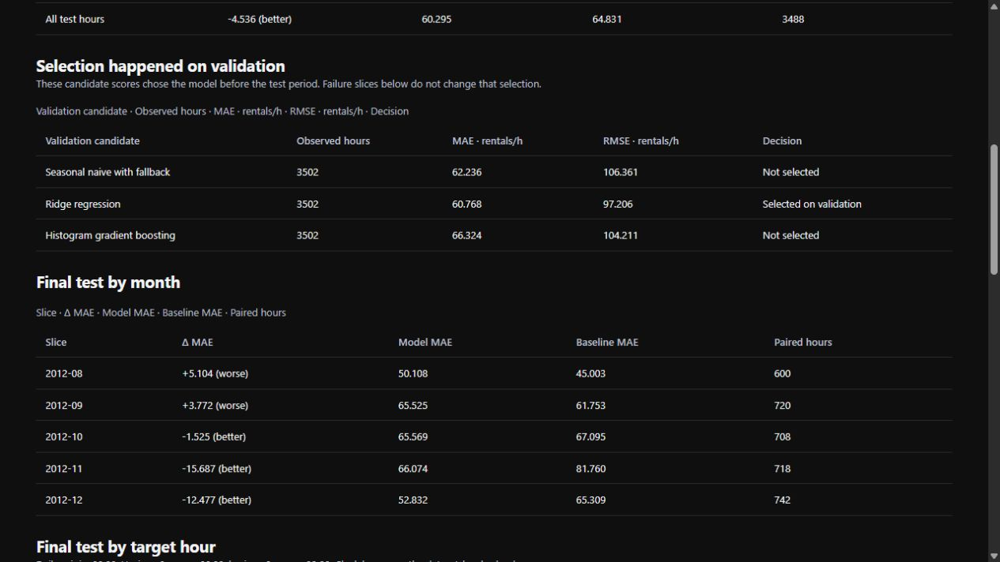
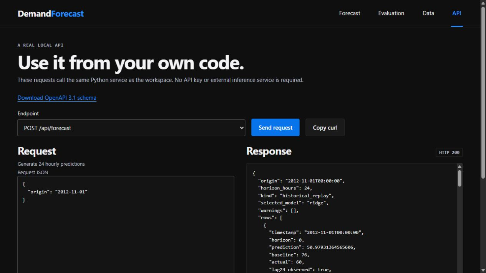
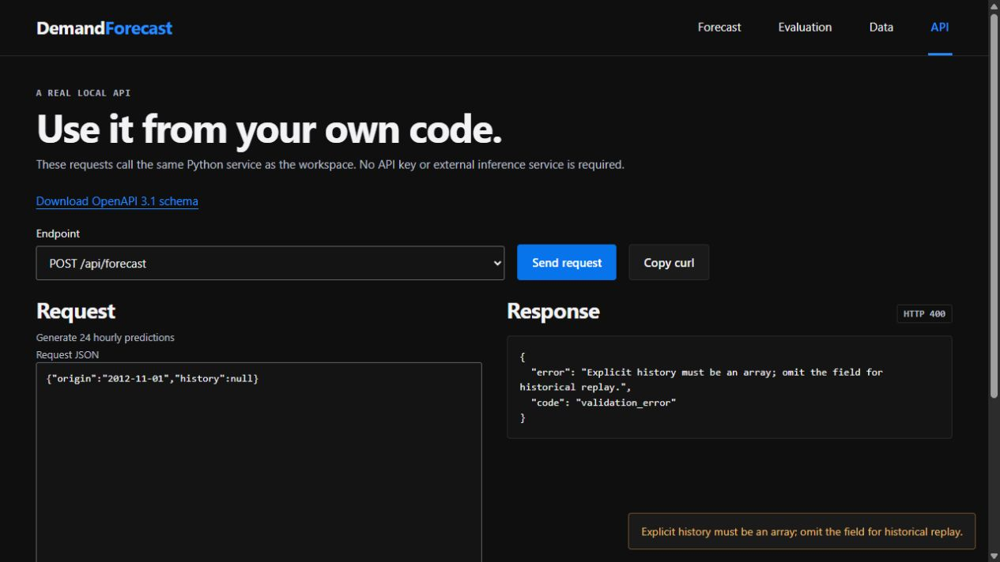

# DemandForecast: application walkthrough

Source version 0.1.1; actual local captures on 2026-10-21.

Fresh screens cover historical replay, mobile, paired holdout diagnostics, API and custom-history fallbacks. A forecast screen does not prove chronology or leakage prevention; retain the timestamp/split tests and recorded prediction rows. Future-city accuracy and prediction intervals remain unestablished.

## Replay a historical day

Generate 24 hourly predictions from the 2012-11-01 origin. Compare the model, seasonal baseline and observed demand; the displayed day has MAE 31.30.

## Read the hourly forecast on mobile

Open the same replay in a narrow browser viewport. The chart and controls remain part of the real local application.

## Judge the entire holdout

Inspect paired errors over 3,488 observed targets. Model MAE is 60.29 versus baseline 64.83; the model still loses in two of five months.

## Locate losses hidden by the mean

Open the final-test monthly/hourly slices. Positive model-minus-baseline error means the model did worse. These comparisons use the same observed targets.

## Request a forecast from code

Send POST /api/forecast to the running Python service. The response contains 24 real predictions and their input provenance.

## Disclose missing custom-history lags

Send an explicit empty history array. The API returns HTTP 200, marks custom_history, uses training medians with warnings and leaves actual values null. It does not borrow hidden archive observations.

## Reject a wrong history type

Send history: null. The API returns HTTP 400 because an explicit history must be an array. This differs from the allowed empty-array fallback.

